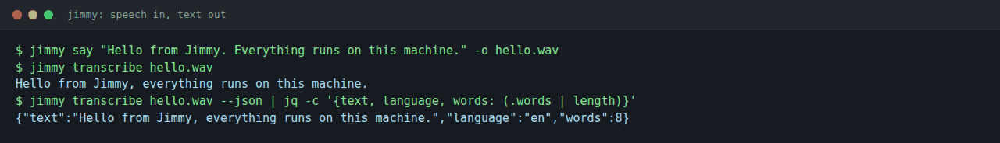
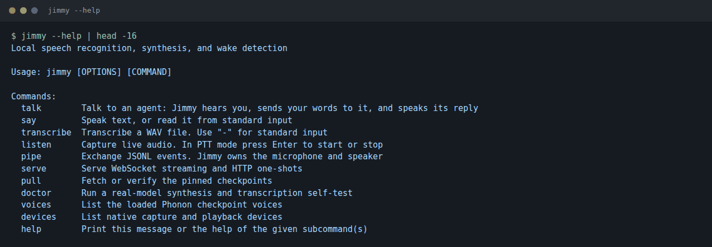
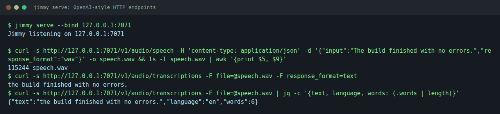
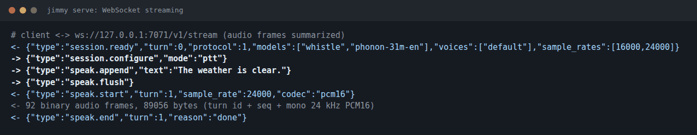

# Jimmy: local voice gateway for speech-to-text, text-to-speech, and wake word

[](https://github.com/dashw00d/jimmy/actions/workflows/check.yml)
[](LICENSE)

**Jimmy is an offline, on-device voice gateway written in Rust.** It transcribes speech with Whistle, synthesizes English speech with Phonon 31m, and wakes on "Hey Jimmy". Use it as a CLI, a JSONL sidecar, a WebSocket and OpenAI-style HTTP server, a Rust library, or a browser package. Both models run on the CPU, and no cloud speech API is involved.



## Why Jimmy

Giving an AI agent or app ears and a voice usually means wiring up a speech-to-text service, a text-to-speech service, a voice activity detector, and a wake word detector. Jimmy packages that into one binary with one protocol.

- It holds no agent logic. It emits transcripts and speaks text, and the caller decides what the words mean.
- Models run locally. Audio stays on your machine unless you point `jimmy talk` at a remote agent, and then only the transcribed text is sent.
- Wake word detection needs no third model. A voice activity detector gates Whistle, and Jimmy matches the transcript against the wake phrase, so the phrase is a runtime flag rather than a trained artifact.
- The same control events and PCM frames work over stdio, WebSocket, a Rust API, and a browser Worker.

## Features

- **Speech-to-text** with Whistle, a 16.9 MB model that hears seven languages. Optional `--language` and `--keyword` hints, and word timestamps with probabilities in `--json` output.
- **Text-to-speech** with Phonon 31m, English, with custom voices via `--voice-file` and speed from 0.5 to 2.
- **Wake word** "Hey Jimmy" by default, configurable with `--wake`. A standalone wake phrase gets a short spoken reply, and a same-breath command such as "Hey Jimmy, what's the weather?" is transcribed directly.
- **Talk to any agent** with `jimmy talk`: Codex CLI, Claude Code CLI, Ollama, any OpenAI-compatible chat completions server, or any program that reads stdin.
- **Listening modes**: wake, push-to-talk, and open (continuous) mode.
- **Interruption**: new speech stops the reply in progress, and the protocol reports cancelled turns so clients can clear buffered audio.
- **Server**: WebSocket streaming at `/v1/stream`, plus `POST /v1/audio/speech` and `POST /v1/audio/transcriptions`. Public binds require a bearer token and an origin allowlist.
- **Browser**: the `jimmy-web` package runs the engines in a Worker (WebAssembly, optional WebGPU TTS) or connects to a remote Jimmy WebSocket.
- **Offline builds**: `--features bundled` embeds the models, and the bundled executable was tested with its network proxies pointed at an unavailable port. Opus output is available with `--features opus`.
- **Platforms**: Linux x64 and ARM64, macOS (Apple silicon and Intel), and Windows x64 build targets are in the [build matrix](.github/workflows/check.yml). See [TEST_RESULTS.md](TEST_RESULTS.md) for what has actually been verified on which platform.

## Install

```sh
curl -fsSL https://raw.githubusercontent.com/dashw00d/jimmy/main/scripts/install.sh | sh
```

This downloads the latest release for Linux or macOS, checks its SHA-256 and installs `jimmy` to `~/.local/bin`. On Windows, download `jimmy-x86_64-pc-windows-gnullvm.zip` from [Releases](https://github.com/dashw00d/jimmy/releases). Then run `jimmy pull` to fetch the voice models.

## Quick start

To build from source instead, use Rust 1.99 or later. On Debian or Ubuntu, install the build dependencies first (LLVM 21 libc++ and the ALSA headers):

```sh
sudo apt-get install -y libasound2-dev libc++-21-dev libc++abi-21-dev
```

Then build and try it:

```sh
cargo build --locked --release -p jimmy
target/release/jimmy pull                      # download and verify the pinned models
target/release/jimmy say "Hello from Jimmy." -o hello.wav
target/release/jimmy transcribe hello.wav
target/release/jimmy doctor --json             # full synthesis and transcription self-test
target/release/jimmy talk                      # say "Hey Jimmy", then ask a question
target/release/jimmy serve --bind 127.0.0.1:7071
```

`jimmy talk` needs a microphone, speakers, and an agent (Codex CLI, Claude Code CLI, or Ollama). Run `jimmy devices` to list capture and playback devices.



### Build details

Linux needs the CPAL ALSA development package and LLVM 21 or newer C++ and C++ ABI static libraries. Set `JIMMY_CXX_LIB_DIR` if those archives are outside the standard LLVM directory. The x64 Linux and Windows builds target x86-64-v3, which includes AVX2.

Windows uses the Rust `x86_64-pc-windows-gnullvm` target with LLVM-MinGW. Set the Cargo linker to the toolchain's `x86_64-w64-mingw32-clang` and `JIMMY_CXX_LIB_DIR` to its `x86_64-w64-mingw32/lib` directory. Intel macOS embeds the vendor's dylib from its macOS wheel. The other supported builds link the vendor archive. See the [build matrix](.github/workflows/check.yml).

`cargo install --locked --path crates/jimmy` installs from this workspace. Release packaging includes a shell installer, a PowerShell installer, a Homebrew formula generator, and SBOM and checksum generation. See [scripts](scripts).

Models download to the user cache on first use. `--model-dir DIR` uses only local files. Put `whistle.cact` at the root and a Phonon checkpoint under `phonon/`. `jimmy pull --json` reports the cache directory. For an offline executable, set `JIMMY_BUNDLE_DIR` to the absolute path of that pinned cache and build with `--features bundled`. Bundled builds populate the cache from embedded assets. `JIMMY_CACTUS_ARTIFACTS` can point the build script to a local copy of the pinned Cactus runtime artifact tree.

Flags take precedence over `JIMMY_*` variables and `jimmy.toml`. `jimmy --help` lists the settings. Use `--voice-file path.safetensors` to load a custom voice and `jimmy voices` to list names. Voice defaults to the English checkpoint's own default. Rates from 0.5 to 2 are applied to the PCM stream, which changes pitch with speed.

## Usage examples

Transcribe a WAV file to text, or to JSON with word timings:

```sh
jimmy transcribe meeting.wav
jimmy transcribe meeting.wav --json --keyword Whistle,Phonon
```

Synthesize speech to a file, or from standard input:

```sh
echo "Build finished." | jimmy say -o done.wav
jimmy say "Slower and lower." --rate 0.8
```

Run the server and call it over HTTP. Speech takes JSON with `input`, optional `voice`, optional `speed`, and `response_format` of `wav` or `pcm`. Transcription takes a multipart WAV file.

```sh
jimmy serve --bind 127.0.0.1:7071

curl -s http://127.0.0.1:7071/v1/audio/speech \
  -H 'content-type: application/json' \
  -d '{"input":"The build finished with no errors.","response_format":"wav"}' -o speech.wav
curl -s http://127.0.0.1:7071/v1/audio/transcriptions -F file=@speech.wav -F response_format=text
```



Stream over a WebSocket. The server sends `session.ready` first, then JSON control events and binary audio frames (details under [Interfaces and protocol](#interfaces-and-protocol)):



The screenshots above are real output from the release binary. `scripts/screenshots.py` regenerates them.

## How it works

```text
microphone / client audio --> VAD --> Whistle (STT) --> transcript, wake phrase match
                                                              |
                                      your agent, app, or `jimmy talk` <--+
                                                              |
text to speak ----------------------> Phonon (TTS) --> 24 kHz PCM16 audio
```

- **Whistle** (speech-to-text) and **Phonon 31m** (text-to-speech) run through the Cactus runtime and the `ptts` crate. Pinned versions, revisions, and licenses are in [THIRD_PARTY.md](THIRD_PARTY.md).
- Jimmy implements the streaming layer itself: voice activity detection, stable partial transcripts, endpointing, wake phrase matching, follow-up windows, and cancellation.
- The workspace is split into crates: `jimmy-proto` (the wire protocol), `jimmy-core` (the session state machine, usable from Rust with your own `Stt` and `Tts`), `jimmy-whistle`, `jimmy-phonon`, `jimmy-audio` (capture, playback, WAV), `jimmy-web` (the same core compiled to WebAssembly), and `jimmy` (the CLI and server).
- `web/` holds the `jimmy-web` npm package. See the [design notes](Jimmy%20build%20plan.md) for the reasoning behind these choices.

## Requirements

- Rust 1.99 or later to build from source. Release downloads need no toolchain.
- Linux: the ALSA development package and LLVM 21 or newer libc++ and libc++abi. x86-64 builds target x86-64-v3 (AVX2).
- Disk space for the models: Whistle 16.9 MB and Phonon 31m 64.5 MB.
- For `jimmy talk`: a microphone, speakers, and Codex CLI, Claude Code CLI, Ollama, an OpenAI-compatible server, or your own program.
- For `jimmy-web`: a secure browser context with Wasm SIMD, and Node 22 or later to build.

## Wake replies

Run `jimmy talk` or `jimmy listen`, say “Hey Jimmy,” and pause. Jimmy rotates through “What's up?”, “How can I help?”, “Go ahead,” and “I'm here” after the default 600 ms silence timeout. Phonon speaks the greeting locally. By default, you have eight seconds after the greeting to ask your question without repeating the wake phrase. If you say “Hey Jimmy, what's the weather?” in one breath, Jimmy transcribes the question directly. `jimmy talk` sends the question to an agent. With `jimmy listen` or the other interfaces, the caller answers.

Use `jimmy listen --wake-reply=false` to keep wake mode silent. Sidecar, WebSocket, and browser clients can set `wake_reply: false` in `session.configure` to supply their own greeting. The option applies in wake mode. Without a spoken reply, Jimmy keeps the turn open for up to 3 seconds of silence after a standalone “Hey Jimmy”, so “Hey Jimmy … what's going on?” arrives as one `transcript.final`. If no command follows, the turn ends with an empty `transcript.final`, the signal to play your own greeting.

The wake phrase is matched anywhere in what Jimmy hears, so “Um, hey Jimmy, …” or a retry right after other speech still wakes it. Words before the phrase are dropped.

## Talk to an agent

```sh
jimmy talk
```

Say “Hey Jimmy,” then your question. Jimmy transcribes it on the device, sends it to an agent, and speaks the reply as it arrives. For eight seconds after a reply, you can ask a follow-up without the wake phrase. Running `jimmy` with no command does the same thing.

With no agent named, Jimmy uses the first one it finds: the Codex CLI, then the Claude Code CLI, then a local Ollama server. Name one to choose.

| Command | Agent |
| --- | --- |
| `jimmy talk codex` | Codex CLI, GPT-6.1 Terra at medium effort, read-only with tools off |
| `jimmy talk claude` | Claude Code CLI, Haiku with tools off |
| `jimmy talk ollama` | Ollama at `localhost:11434`, first installed model |
| `jimmy talk http://localhost:1234/v1` | Any OpenAI-compatible chat completions server. Set `JIMMY_API_KEY` if it needs a key. |
| `jimmy talk "python3 bot.py"` | Any shell command |
| `jimmy talk -- my-agent --flag` | Any program, run without a shell |

Add `--model NAME` to pick a model. To make a choice stick, put `agent = "claude"` and `agent_model = "sonnet"` in `jimmy.toml`, or set `JIMMY_AGENT` and `JIMMY_AGENT_MODEL`.

### Hook up your own program

A program only has to read stdin and print its answer. Jimmy runs it once per question and speaks its output while it prints. Jimmy passes:

- **stdin**: your words, with up to eight recent exchanges for context once there are any
- **`JIMMY_TEXT`**: only your latest words
- **`JIMMY_HISTORY`**: the recent exchanges as JSON, `[{"user": "...", "assistant": "..."}]`
- **`JIMMY_TURN`**: the turn number

```sh
jimmy talk 'echo "You said $JIMMY_TEXT"'
```

If the reply takes more than two seconds to start, Jimmy says “Hmm” once to fill the pause. If you speak again, it stops the reply in progress. If the program fails, Jimmy says so aloud and prints the error output.

`jimmy listen` only prints transcripts and never answers. For full control over turns and audio, use the [interfaces](#interfaces) below.

To test a two-turn conversation end to end on Linux, run the following. It plays speech into a virtual microphone and records a virtual speaker, so your real devices are not used.

```sh
python3 scripts/tests/talk.py target/release/jimmy          # or add: claude, ollama, -- my-agent
```

The older WebSocket Codex bridge, `scripts/jimmy_codex.py`, still works, and `scripts/tests/conversation.py` tests it.

## Interfaces and protocol

- `listen` and `pipe` default to wake mode. Use `--mode open` for continuous speech detection or `--mode ptt` for push-to-talk. In interactive `listen --mode ptt`, Enter toggles the microphone turn.
- `jimmy pipe --cue-dir ./cues` exchanges JSONL on stdin and stdout. Jimmy handles the device and caches WAV cues using the filenames as IDs. On native speakers, use the wake phrase or PTT to interrupt output. A client that has echo cancellation can enable open-mic interruption.
- `jimmy serve` exposes `/v1/stream`, `POST /v1/audio/speech`, and `POST /v1/audio/transcriptions`. Public binds require a bearer token and an exact origin allowlist. For a public HTTPS service, terminate TLS in front of Jimmy.
- HTTP speech takes JSON with `input`, optional `voice`, optional `speed`, and `response_format` of `wav` or `pcm`. HTTP transcription takes multipart WAV with optional `language`, `prompt` for keyword boosting, and `response_format` of `json`, `verbose_json`, or `text`.
- Rust hosts create a `jimmy_core::Session` with implementations of `Stt` and `Tts`. Call `push_audio`, `push_event`, `poll`, and `pull_audio` on the session's worker.
- See [jimmy-web](web/README.md) for the local Worker and remote WebSocket client.

The server sends `session.ready` with `protocol: 1`. WebSocket input audio is raw mono PCM16 little-endian at 16 kHz unless configured otherwise. Output audio has a little-endian turn ID and sequence number, four bytes each, followed by mono 24 kHz PCM16. Build with `--features opus` to enable Opus output on the server. Control types live in [jimmy-proto](crates/jimmy-proto/src/lib.rs). Clients should clear the old turn's buffered playback when `speak.end` reports `cancelled`.

```json
{"type":"session.configure","mode":"wake","wake":"hey jimmy"}
{"type":"speak.append","text":"The weather is clear."}
{"type":"speak.flush"}
{"type":"speak.stop","turn":1}
{"type":"cue.play","id":"chime"}
{"type":"cancel","turn":1}
```

## Tests

```sh
cargo test --locked --workspace
cargo clippy --locked --workspace --all-targets -- -D warnings
python scripts/tests/native.py target/release/jimmy /path/to/models
python scripts/tests/roundtrip.py target/release/jimmy /path/to/models
python scripts/tests/integration.py target/release/jimmy /path/to/models --browser /path/to/chromium --audio-worklet
```

The Python harnesses use `pyarrow`, `websockets`, `playwright`, and FFmpeg. The native conformance test uses ALSA's null device. On other operating systems, pass `--skip-pipe`. Add `--strict-latency` to enforce the desktop WebSocket target. See [test results](TEST_RESULTS.md).

To score a recorded wake soak, prepare a continuous audio file with known wake phrases and put each start time in seconds on a separate line in `markers.txt`.

```sh
cargo build --release -p jimmy --example wake_soak
ffmpeg -v error -i soak.wav -f s16le -ac 1 -ar 16000 - \
  | target/release/examples/wake_soak /path/to/models/whistle.cact > wakes.jsonl
python scripts/tests/score_soak.py wakes.jsonl markers.txt
```

Vendor versions and licenses are recorded in [Third-party engines and checkpoints](THIRD_PARTY.md).

## License

Jimmy is licensed under the [Apache License 2.0](LICENSE). Third-party engines and checkpoints keep their own licenses; see [THIRD_PARTY.md](THIRD_PARTY.md).
